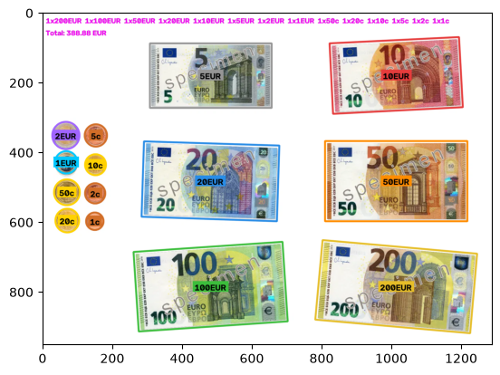
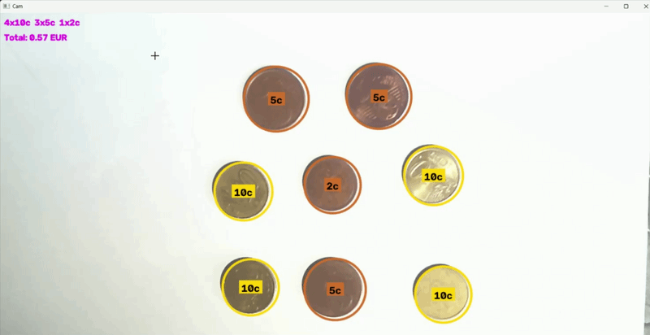
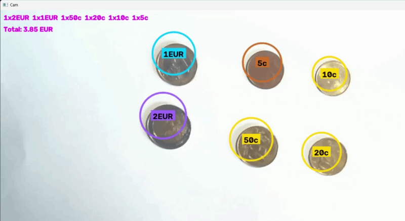
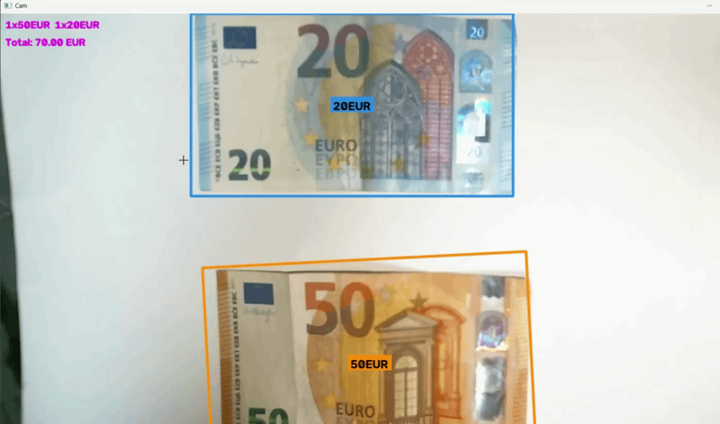
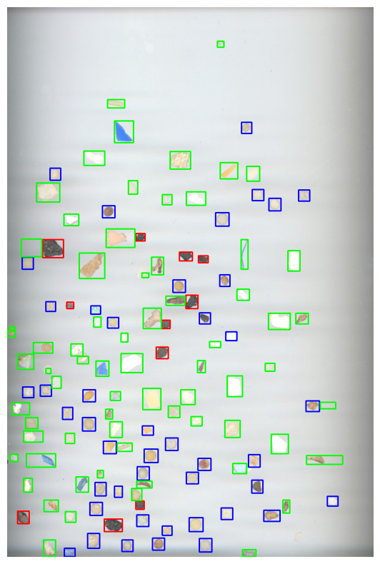
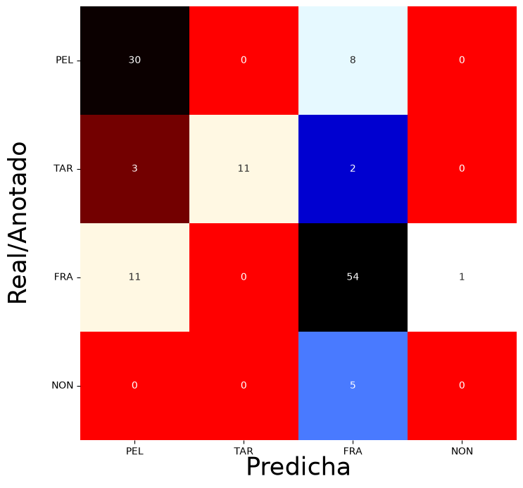

# Práctica 3

Este repositorio contiene el cuaderno `VC_P3.ipynb`, con dos tareas de detección y reconocimiento de formas: contar el dinero (monedas y billetes de euro) de una imagen o de la cámara en vivo, y clasificar microplásticos en tres clases. En ninguna de las dos se usan modelos de aprendizaje profundo.

### Autores:
- [Sergio Rodriguez Rubio](https://github.com/SergioRodriguezEnt)
- [Arael Jesús Almeida González](https://github.com/xAraelx)

------

## Estructura de la carpeta

```
P3
|- Billetes.gif                       #Demostración en vivo de la detección de billetes
|- Billetes.png                       #Imagen esquema con billetes y monedas para la tarea 1
|- DeteccionBilletesMonedasImg.png    #Resultado de la tarea 1 sobre Billetes.png
|- DeteccionMicroPlasticos.png        #Resultado de la tarea 2 sobre MPs_test.jpg
|- FRA.png, PEL.png, TAR.png          #Subimágenes de entrenamiento de cada clase
|- fragment-03-olympus-10-01-2020.JPG #Imagen de entrenamiento de fragmentos
|- pellet-03-olympus-10-01-2020.JPG   #Imagen de entrenamiento de pellets
|- tar-03-olympus-10-01-2020.JPG      #Imagen de entrenamiento de alquitrán
|- MatrizConfu.png                    #Ejemplo de matriz de confusión del enunciado
|- MatrizDeConfucion.png              #Matriz de confusión obtenida en la tarea 2
|- Monedas.jpg                        #Imagen ideal de monedas del enunciado
|- Monedas1.gif                       #Demostración en vivo con monedas de bronce y oro
|- Monedas2.gif                       #Demostración en vivo con una moneda de cada tipo
|- MPs_test.jpg                       #Imagen de test de la tarea 2
|- MPs_test_bbs.csv                   #Anotaciones de la imagen de test
|- README.md                          #Descripción de la solución a las tareas
|- VC_P3.ipynb                        #Cuaderno jupyter con tareas desarrolladas
```

## Recursos necesarios

Se puede usar el mismo *environment* de las prácticas anteriores (OpenCV, NumPy y Matplotlib). Para la matriz de confusión y las métricas de la tarea 2 hay que instalar además `scikit-learn`, `seaborn` y `scipy`:

- `pip install scikit-learn seaborn scipy`

El demostrador en vivo de la tarea 1 necesita una **cámara web**. La cámara se abre con `cv2.CAP_DSHOW` (Windows) para que se apliquen los controles de exposición y balance de blancos.

------

## Tarea 1 — Contar el dinero de una imagen y en vivo

### Monedas

Como la escala de la imagen es desconocida, en lugar de pedir al usuario que marque una moneda de referencia, el valor de cada moneda se deduce de **las proporciones entre los diámetros** de las monedas de la misma serie, junto con su **color**.

1. **Localización** (`detectar_monedas`): se estima el fondo (el folio) con una mediana de ventana grande en Lab y se umbraliza la diferencia de color con él. El umbral se calcula con la mediana y la MAD del ruido, así que aguanta degradados de luz y fondos de cualquier color. De cada contorno se comprueba la circularidad y se obtiene el radio a partir del área (con precisión subpíxel). Si dos monedas quedan unidas por una sombra, se separan con aperturas cada vez mayores. Como alternativa existe `localizar_hough` (`USAR_HOUGH = True`), con `HoughCircles`.
2. **Tipo por color** (`tipos_de_monedas`): con el canal `a` de Lab se separan las monedas de **bronce** (1, 2, 5 c) de las de **oro** (10, 20, 50 c). El corte se busca como el mayor salto entre las monedas del propio frame, por lo que no depende del tinte de la cámara. Si el centro y el anillo tienen colores muy distintos, la moneda es bimetálica: **1 €** (centro plateado) o **2 €** (centro dorado).
3. **Valor por tamaño** (`clasificar`): dentro de cada serie se agrupan las monedas por radio. Con 3 tamaños el valor es directo, y con 2 se elige el par de monedas cuya proporción de diámetros oficiales más se parece a la medida. Si una serie tiene un solo tamaño, se compara con una moneda ya conocida (por ejemplo, una de 1 €). Si todas las monedas son iguales no hay referencia, y se muestran los posibles totales.
4. **Seguimiento** (`Seguimiento`): en el vídeo, cada moneda se asocia con la más cercana del análisis anterior y su valor se decide por votación entre los últimos análisis, para que las etiquetas no parpadeen.

### Extensión: billetes de la serie Europa

Con `DETECTAR_BILLETES = True` también se detectan billetes:

1. **Segmentación** (`detectar_billetes`): diferencia de color con el folio + bordes débiles (Canny), cierre, relleno de las zonas pálidas del billete y apertura. Solo se busca dentro del folio, para que la mesa no se pegue a los billetes. Se aceptan los contornos grandes, rectangulares y con la proporción de un billete, aunque esté algo arrugado o doblado.
2. **Monedas falsas**: los círculos detectados dentro de un billete (números y dibujos impresos) se descartan.
3. **Clasificación por color** (`medir_color_billete`, `clasificar_billete`): según el tono en Lab respecto al color del folio, gris → 5 €, rojo → 10 €, azul → 20 €, naranja → 50 €, verde → 100 € y amarillo-marrón → 200 €. Si el tono queda en la frontera entre 50 € y 200 € y hay monedas que den la escala, decide el largo del billete (140 mm frente a 153 mm).

**Resultado con la imagen esquema `Billetes.png`** (todos los billetes y una moneda de cada tipo, 388,88 €):



### Demostrador en vivo

El demostrador analiza un frame de la cámara cada `ANALIZAR_CADA` frames y dibuja sobre la imagen cada moneda o billete con su valor, el recuento por tipo y el total.

| Tecla | Acción |
|---|---|
| `ESPACIO` | Guarda el frame en `captura.png`, lo analiza y lo muestra |
| `TAB` / `v` | Alternar entre la cámara y la última captura |
| `q` / `ESC` | Salir |

**Monedas de bronce y oro:**



**Una moneda de cada tipo (incluidas las de 1 € y 2 €):**



**Billetes:**



**¿Funciona correctamente? Problemas observados:**
- Funciona bien con las monedas separadas sobre un folio blanco y con luz uniforme.
- Si todas las monedas son del mismo tamaño no hay ninguna referencia, así que no se puede saber su valor y se muestran las opciones posibles.
- Las sombras y los reflejos afectan al color: el tinte de la cámara hacía que el bronce y el oro se confundieran, por eso se compara el color de las monedas entre sí y no con umbrales fijos.
- Las monedas que se tocan o se solapan mucho no siempre se separan.
- Los umbrales de color de los billetes están ajustados solo con billetes de 20 € y 50 € reales. El resto se ha comprobado con la imagen esquema (`DEBUG_BILLETES = True` muestra las medidas para recalibrar).

------

## Tarea 2 — Clasificación de microplásticos

Las partículas se clasifican en **pellets (PEL)**, **alquitrán (TAR)** y **fragmentos (FRA)** con reglas sobre características geométricas y de color, ajustadas solo con las imágenes de entrenamiento. La imagen de test se usa únicamente para evaluar.

### Segmentación

El fondo del escáner tiene franjas horizontales y viñeteado, así que un umbral global no funciona. En su lugar:

- `diferencia_fondo`: el fondo se estima con una **mediana alargada en horizontal** (sigue las franjas sin "comerse" los objetos) y se umbraliza la distancia de color en Lab de cada píxel a él.
- `oscuridad_relativa`: gris de cada píxel dividido por el del fondo local, que no depende de la exposición.
- `forma`: de cada componente se calculan la **redondez** (4πA/P²), la **solidez** (área / área de la envolvente convexa) y la **relación entre los ejes de la elipse** ajustada, basadas en las características de [SMACC](https://doi.org/10.1109/ACCESS.2020.2970498).

### Clasificación

Las clases se buscan en orden, y cada una descarta lo que ya han encontrado las anteriores (prioridad pellet > alquitrán > fragmento):

1. **Pellets** (`obtener_PEL`): objetos del tamaño esperado, muy redondos, sólidos y poco alargados, cuyo interior no es oscuro y sin color.
2. **Alquitrán** (`obtener_TAR`): manchas cuya mediana es oscura respecto al fondo (`OSCURO = 0.70`) y casi sin color (`CROMA_TAR = 5.5`), con forma de gota. Las piezas negras muy alargadas o triangulares se consideran plástico.
3. **Fragmentos** (`obtener_FRA`): todo lo demás que se distingue del fondo. Un "alquitrán" rodeado casi por completo de objeto se reinterpreta como una mancha de un fragmento. Se descartan las sombras del borde y las rayas finas.

Las cajas de una misma clase que se solapan mucho se unen, y las que solo se rozan se recortan (`fusionar_cajas`). Además, la **escala** se estima automáticamente a partir de los objetos redondos de la imagen (`estimar_r_med`), y la imagen se redimensiona a la escala con la que se calibraron los umbrales.

### Evaluación

`chequeo` empareja cada partícula anotada en `MPs_test_bbs.csv` con la caja calculada que más se solapa con ella (cada caja se usa una sola vez). Las partículas anotadas sin detectar y las detecciones sin anotación se cuentan como `NON`.

**Resultados con `MPs_test.jpg`** (azul = pellet, rojo = alquitrán, verde = fragmento):



| Métrica (media ponderada) | Valor |
|---|---|
| Accuracy | 0.760 |
| Precision | 0.748 |
| Recall | 0.760 |
| F1 Score | 0.749 |



| Clase | Anotadas | Aciertos | Recall | Precision |
|---|---|---|---|---|
| PEL | 38 | 30 | 0.79 | 0.68 |
| TAR | 16 | 11 | 0.69 | 1.00 |
| FRA | 66 | 54 | 0.82 | 0.78 |

**Análisis:**
- Todo lo que se clasifica como alquitrán lo es (precisión 1.00), pero algunas manchas de alquitrán se confunden con pellets o fragmentos.
- La confusión principal es entre pellets y fragmentos: los fragmentos pequeños y redondeados parecen pellets (11), y algunos pellets irregulares o pegados a otros objetos se toman como fragmentos (8).
- Solo una partícula anotada no se detecta, y hay 5 detecciones de fragmentos sin anotación (sombras o restos del escáner).

------

## Referencias

- [Guía de la Práctica 3](https://github.com/otsedom/otsedom.github.io/tree/main/VC/P3)
- [SMACC: A System for Microplastics Automatic Counting and Classification](https://doi.org/10.1109/ACCESS.2020.2970498)
- [Documentación de OpenCV](https://docs.opencv.org/)
- [Métricas de clasificación (scikit-learn)](https://scikit-learn.org/stable/modules/model_evaluation.html)
- [Resumen del proceso de obtención del código de detección de dinero (chat con Claude)](https://claude.ai/share/4c98ada4-249f-490d-aff2-53c6ff5770ee)
- [Resumen del proceso de obtención del código de detección de microplásticos (chat con Claude)](https://claude.ai/share/3eaf0d5c-c24d-41e8-8571-4c344c4986ab)
