# Práctica 4 y 4b

Este repositorio contiene el cuaderno `VC_P4.ipynb`, que reúne las dos partes de la práctica 4:

- **P4 — Detección:** un prototipo que procesa vídeo para detectar y seguir personas y vehículos, localizar sus matrículas y contarlos. El detector de matrículas se ha entrenado de tres formas distintas: YOLO11n, RT-DETR con Ultralytics y RT-DETR con el repositorio oficial, sin Ultralytics.
- **P4b — OCR:** lee el texto de las matrículas y compara un OCR clásico (Tesseract) con un modelo de lenguaje visual (PaddleOCR-VL).

### Autores:
- [Sergio Rodriguez Rubio](https://github.com/SergioRodriguezEnt)
- [Arael Jesús Almeida González](https://github.com/xAraelx)

------

## Índice

1. [Estructura de la carpeta](#estructura-de-la-carpeta)
2. [Recursos necesarios](#recursos-necesarios)
3. [Tarea 1 — Detección y seguimiento](#tarea-1--detección-y-seguimiento-de-personas-vehículos-y-matrículas)
   - [Dataset](#dataset-de-matrículas) 
   - [Entrenamiento](#entrenamiento) 
   - [RT-DETR sin Ultralytics](#rt-detr-sin-ultralytics-extra) 
   - [Comparativa de detectores](#comparativa-de-los-tres-detectores-extra) 
   - [Pipeline de vídeo](#pipeline-de-vídeo) 
   - [Flujo](#extra-flujo-por-direcciones) 
   - [Anonimización](#extra-anonimización)
4. [Tarea 2 — OCR](#tarea-2--reconocimiento-de-caracteres-en-las-matrículas)
   - [OCR](#ocr) 
   - [Comparativa Tesseract vs PaddleOCR-VL](#comparativa-tesseract-vs-paddleocr-vl)
5. [Referencias](#referencias)

------

## Estructura de la carpeta

```
P4
|- VC_P4.ipynb                     #Cuaderno jupyter con las tareas desarrolladas
|- README.md                       #Descripción de la solución a las tareas
|- load_rtdetr.py                  #Carga de los modelos del repositorio oficial de RT-DETR
|- RT-DETR/                        #Repositorio oficial de RT-DETR (lyuwenyu/RT-DETR)
|- mandril.jpg                     #Imagen con la que se tapan personas y matrículas al anonimizar
|- tracker_general.yaml            #Configuración del tracker de personas y vehículos
|- tracker_matriculas.yaml         #Configuración del tracker de matrículas
|- datos/                          #Dataset de matrículas (imágenes en el enlace del apartado Dataset)
|   |- annotations/                #Anotaciones originales en JSON (caja + texto de la matrícula)
|   |- data.yaml, train.txt, val.txt
|   |- coco_train.json, coco_val.json  #El mismo reparto en formato COCO, para el repositorio oficial
|- runs/
|   |- detect/train-3/             #Entrenamiento de YOLO11n (best.pt y curvas)
|   |- detect/rtdetr-2/            #Entrenamiento de RT-DETR-l con Ultralytics (best.pt y curvas)
|   |- rtdetr_nativo/              #Entrenamiento de RT-DETRv2-L sin Ultralytics (best.pth, log.txt, results.png)
|- results/
    |- yolo_paddle_detecciones.csv #Detecciones y seguimiento de cada fotograma del vídeo de test
    |- yolo_paddle_totales.csv     #Total de objetos únicos por clase
    |- yolo_paddle_matriculas.csv  #Texto leído de cada matrícula
    |- yolo_paddle_flujo.csv       #Salidas por dirección de cada clase
    |- comparativa_detectores/     #Tablas, gráficas y curvas de los tres detectores
    |- comparativa_ocr/            #Tablas y gráficas de Tesseract vs PaddleOCR-VL
```

El vídeo de test (`C0142.MP4`) y los pesos que se descargan solos (`yolo11s.pt`, `rtdetr-l.pt`, `weights/`) no se incluyen por su tamaño.

Los vídeos de resultado se encuentran en este [DRIVE](https://drive.google.com/drive/folders/1z3AbIQVJxg9jMuxpYFPb0yNetClAjz53?usp=sharing)

## Recursos necesarios

Se ha usado un *environment* `VC_P4` con Python 3.11:

- `pip install ultralytics lap pandas psutil supervision`
- `pip install pytesseract` y el programa [Tesseract](https://github.com/UB-Mannheim/tesseract/wiki) (en Windows se busca en `C:\Program Files\Tesseract-OCR`)
- `pip install "transformers>=5.0.0" pillow` para PaddleOCR-VL
- Para el RT-DETR sin Ultralytics: clonar el [repositorio oficial](https://github.com/lyuwenyu/RT-DETR) en la carpeta `RT-DETR/` e instalar `pip install tensorboard faster_coco_eval thop` (`thop` solo para contar los GFLOPs)
- PyTorch con CUDA ([instrucciones](https://pytorch.org/get-started/locally/)): sin GPU funciona, pero PaddleOCR-VL y RT-DETR son mucho más lentos.

Los pesos preentrenados (`yolo11n.pt`, `yolo11s.pt`, `rtdetr-l.pt` y los de COCO del repositorio oficial) se descargan solos la primera vez que se usan.

### Equipo de pruebas

Todos los tiempos de este README se han medido en este equipo:

| Componente | Valor |
|---|---|
| SO | Windows 11 |
| CPU | AMD Ryzen 7 7735HS |
| RAM | 32 GB |
| GPU | NVIDIA GeForce RTX 4060 Laptop GPU (8 GB) |
| Python | 3.11.18 |
| PyTorch | 2.6.0 (CUDA 12.4) |
| Ultralytics | 8.4.190 |

------

## Tarea 1 — Detección y seguimiento de personas, vehículos y matrículas

### Dataset de matrículas

Los modelos preentrenados no detectan matrículas, así que se ha entrenado un detector propio con un dataset de **1976 imágenes y 4511 matrículas** anotadas. Cada imagen tiene un JSON con la caja de cada matrícula (centro y tamaño normalizados) y su texto (campo `plate`), que se usa después en la comparativa de OCR.

La sección 1 del cuaderno convierte las anotaciones al formato de YOLO y reparte las imágenes al azar (semilla 42): **1581 imágenes (3584 matrículas) para entrenamiento y 395 (927 matrículas) para validación**. Los tres detectores usan exactamente este reparto; para el repositorio oficial se exporta además a formato COCO.

Enlace al dataset: [DRIVE](https://drive.google.com/drive/folders/1RFd6sKH_QMQcpE_w5rWmy8rKiYUY5_SI)

### Entrenamiento

Los tres detectores de matrículas parten de pesos preentrenados en COCO, se entrenan a 640 px y se quedan con la época con mejor resultado en validación.

| Modelo | Implementación | Base | Parámetros | Optimizador | Batch | Épocas | Tiempo de entrenamiento |
|---|---|---|---|---|---|---|---|
| YOLO11n | Ultralytics | `yolo11n.pt` | 2.6 M | Automático de Ultralytics | 16 | 100 | ~2 h |
| RT-DETR-l | Ultralytics | `rtdetr-l.pt` | 32 M | AdamW, lr 1e-4 | 8 | 100 | ~3 h |
| RT-DETRv2-L (ResNet-50) | Repositorio oficial | `rtdetrv2_r50vd_6x_coco_ema.pth` | 42.7 M | AdamW (config del repo) | 4 | 60 de 100 (parado a mano) | ~7 h |

El entrenamiento del RT-DETR nativo se paró a mano en la época 60 de las 100 previstas por el tiempo que llevaba. Por época tardó unos 7 minutos, frente a menos de 2 del RT-DETR de Ultralytics. Las causas probables son:
- carga las imágenes sin *workers* (en Windows harían falta en un script aparte), así que la GPU espera a la CPU en cada lote;
- usa un *batch* más pequeño;
- es un modelo algo mayor.

YOLO11n es el más rápido de entrenar con diferencia: su tamaño le permite usar un *batch* de 16.

*Data augmentation*:
- **YOLO11n:** más variación de saturación y brillo que la de por defecto (día, noche, sombras), rotación de ±5°, cizalla y perspectiva leves, *mixup* suave y **sin volteo horizontal**, porque el texto de una matrícula nunca aparece invertido. Mantiene el *mosaic* de Ultralytics.
- **RT-DETRv2-L (nativo):** las mismas transformaciones de color y geometría que YOLO, con las de `torchvision`, sin volteo, sin *mosaic* y sin *mixup*.
- **RT-DETR-l (Ultralytics):** el *data augmentation* por defecto de Ultralytics.

Los dos RT-DETR se entrenan a 640 px, la resolución de su preentrenamiento, con AdamW y una tasa de aprendizaje baja, que es la receta habitual de los modelos tipo DETR.

**Evolución del mAP de validación de los tres modelos:**

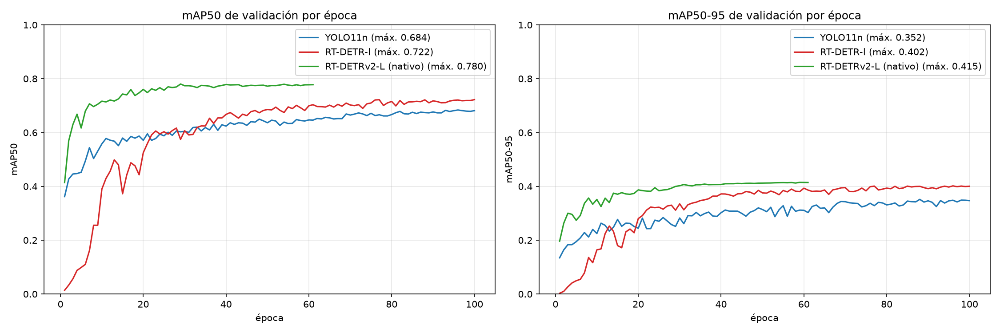

El mAP por época del RT-DETR nativo lo calcula el repositorio con COCOeval, y el de los otros dos el validador de Ultralytics. Por eso estas curvas sirven para ver la tendencia; los valores comparables son los de la tabla de la comparativa.

[PENDIENTE: comentar las curvas, por ejemplo en qué época se estabiliza cada modelo y si alguno sobreajusta]

<details>
<summary>Curvas completas de cada entrenamiento (pérdidas y métricas)</summary>

**YOLO11n:**
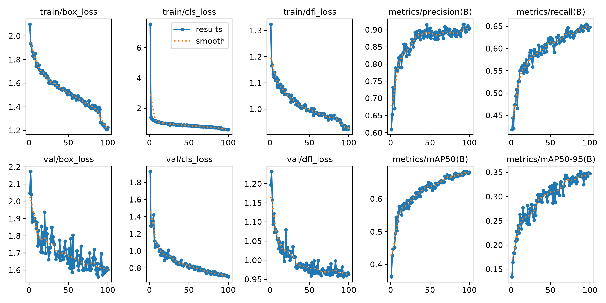

**RT-DETR-l (Ultralytics):**
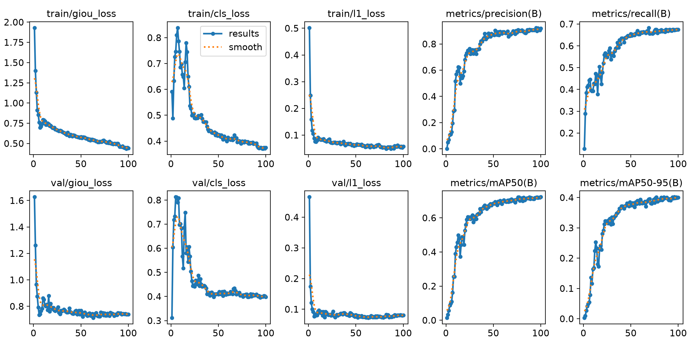

**RT-DETRv2-L (nativo):**
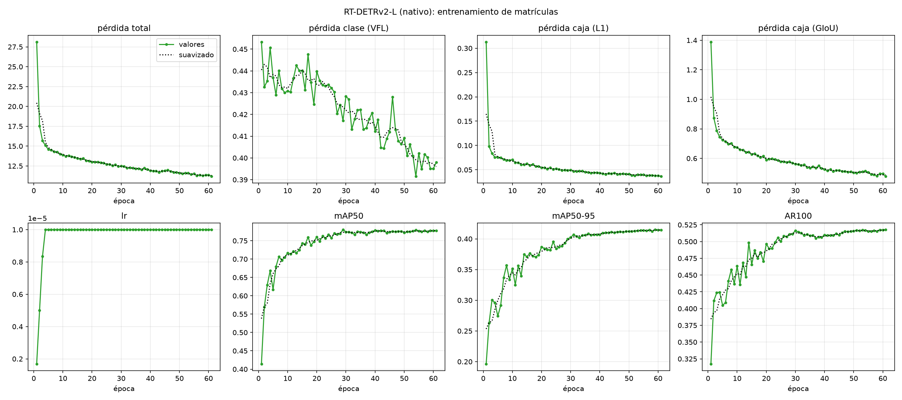

</details>

### RT-DETR sin Ultralytics (extra)

Ultralytics usa licencia AGPL-3.0, que obliga a publicar el código de cualquier aplicación que lo use, mientras que RT-DETR se publicó con licencia Apache 2.0. Por eso, además de la versión de Ultralytics, se ha usado RT-DETR directamente desde su [repositorio oficial](https://github.com/lyuwenyu/RT-DETR): **RT-DETRv2-L** con *backbone* ResNet-50 (sección 2b).

- **Datos:** el repositorio solo lee COCO, así que se exporta a `coco_train.json` y `coco_val.json` el mismo reparto de la sección 1, sin mover imágenes. Al cargar las imágenes se aplica la orientación EXIF, igual que hacen OpenCV y Ultralytics.
- **Entrenamiento:**
  - Se usa el *solver* del repositorio, configurado desde el cuaderno.
  - Se parte de los pesos de COCO y se descarta la cabeza de 80 clases para dejar una sola clase.
  - Se entrena con precisión mixta (AMP), media exponencial de los pesos (EMA) y 3 épocas de calentamiento.
  - El *data augmentation* es equivalente al de YOLO, con las transformaciones de `torchvision`.
  - Sin *workers*, porque en Windows necesitarían un script aparte.
  - Se paró a mano en la época 60 de 100 (unas 7 h). El mejor modelo según el mAP50-95 de validación hasta ese momento queda en `runs/rtdetr_nativo/best.pth`.
- **Integración:** la clase `RTDETRNativo` le da al modelo la misma interfaz que usa el resto del cuaderno (`.names` y `.track()`), así que la comparativa y el pipeline lo usan igual que a los de Ultralytics. Para el modelo general de personas y vehículos se usan los pesos oficiales de COCO, sin reentrenar. Como el repositorio no trae tracking, se usa `ByteTrack` de la librería `supervision`, con los mismos parámetros que los `.yaml` de Ultralytics.
- **Evaluación justa:** las métricas se calculan con las mismas funciones que `model.val()` de Ultralytics (emparejado por IoU de 0,5 a 0,95 y la misma curva precisión-recall) y se guardan las mismas gráficas. Para comparar tamaños, se cuentan solo los pesos EMA en FP16, que es lo que guarda Ultralytics en `best.pt`.

### Comparativa de los tres detectores (extra)

La sección 3 evalúa los tres detectores en las mismas condiciones:
- las 395 imágenes de validación, a 640 px y en el mismo equipo;
- tiempos con *batch* 1, como en el vídeo, después de 10 predicciones de calentamiento;
- la lectura del disco queda fuera de la medida.

Además, calcula para cada modelo el umbral de confianza que maximiza F1, que se usa como `conf_matricula` en el pipeline: cada modelo calibra sus confianzas de forma distinta.

**Detección:**

| Modelo | Precision | Recall | F1 máx. | mAP50 | mAP50-95 | Conf. F1 máx. |
|---|---|---|---|---|---|---|
| YOLO11n | [PENDIENTE] | [PENDIENTE] | [PENDIENTE] | [PENDIENTE] | [PENDIENTE] | [PENDIENTE] |
| RT-DETR-l (Ultralytics) | [PENDIENTE] | [PENDIENTE] | [PENDIENTE] | [PENDIENTE] | [PENDIENTE] | [PENDIENTE] |
| RT-DETRv2-L (nativo) | [PENDIENTE] | [PENDIENTE] | [PENDIENTE] | [PENDIENTE] | [PENDIENTE] | [PENDIENTE] |

**Velocidad y tamaño:**

| Modelo | Inferencia (ms) | Total (ms) | FPS | Parámetros (M) | GFLOPs | Tamaño (MB) |
|---|---|---|---|---|---|---|
| YOLO11n | [PENDIENTE] | [PENDIENTE] | [PENDIENTE] | 2.6 | [PENDIENTE] | [PENDIENTE] |
| RT-DETR-l (Ultralytics) | [PENDIENTE] | [PENDIENTE] | [PENDIENTE] | 32.0 | [PENDIENTE] | [PENDIENTE] |
| RT-DETRv2-L (nativo) | [PENDIENTE] | [PENDIENTE] | [PENDIENTE] | 42.7 | [PENDIENTE] | [PENDIENTE] |

<!-- PENDIENTE: copiar las tablas de results/comparativa_detectores/comparativa.md -->

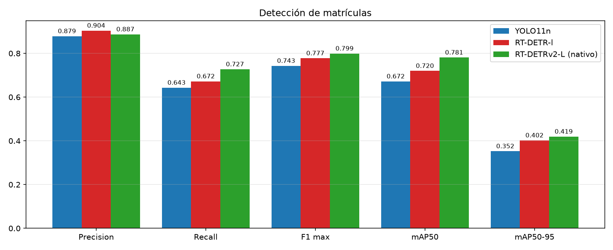

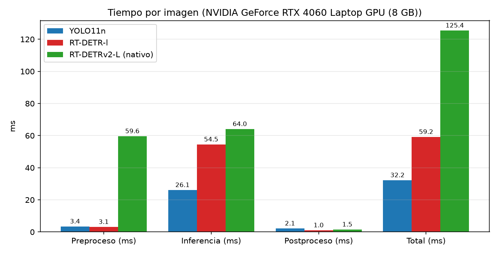

<details>
<summary>Curvas de validación y matrices de confusión de cada modelo</summary>

| | YOLO11n | RT-DETR-l (Ultralytics) | RT-DETRv2-L (nativo) |
|---|---|---|---|
| Precisión-recall | 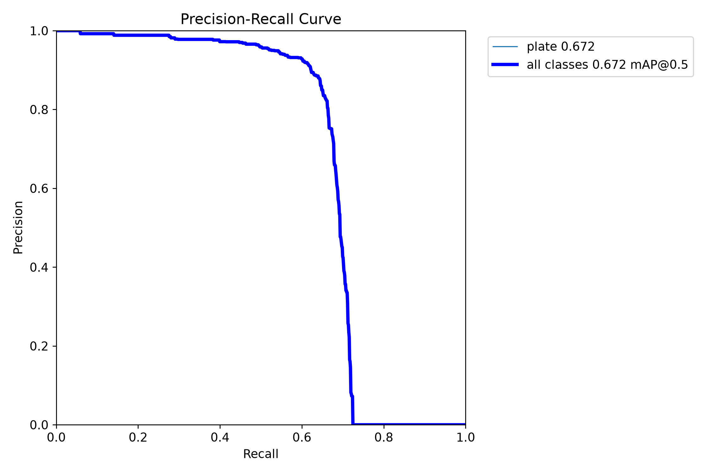 | 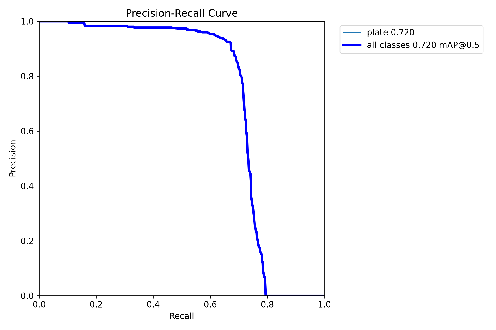 | 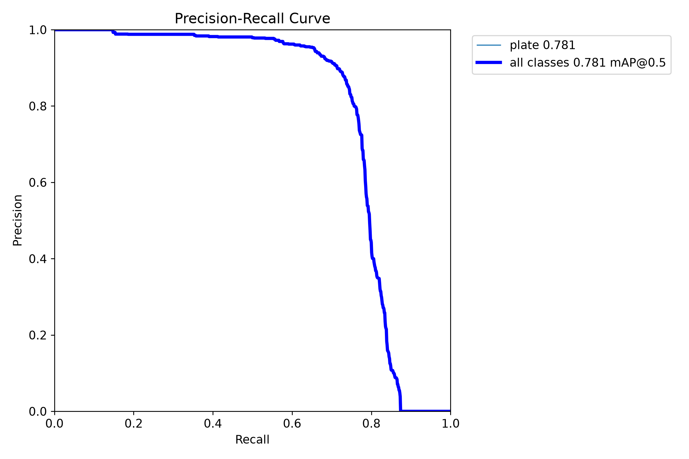 |
| F1 según la confianza | 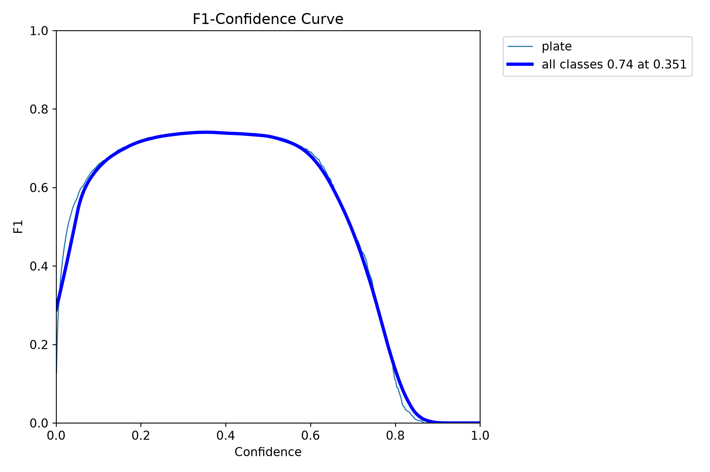 | 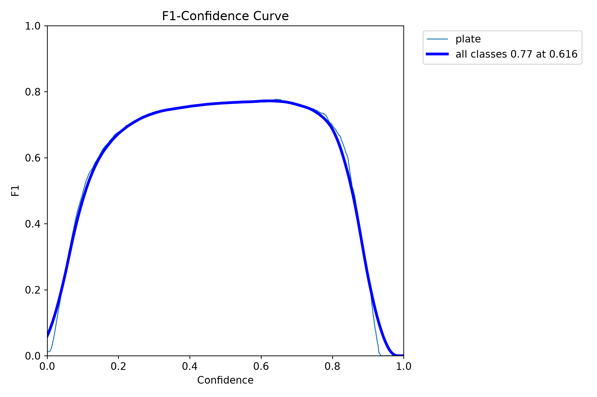 | 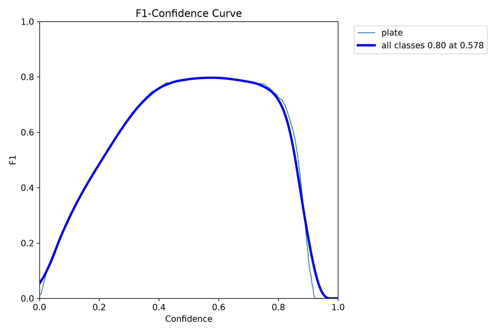 |
| Matriz de confusión | 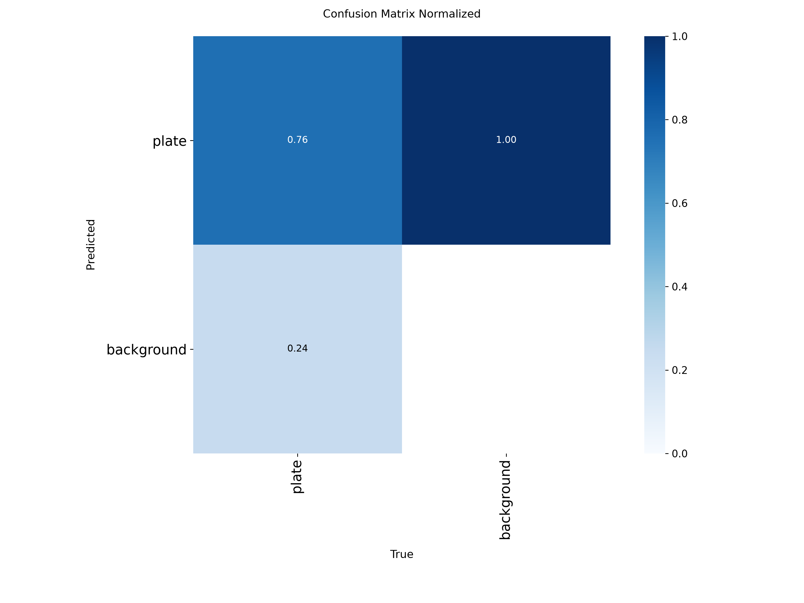 | 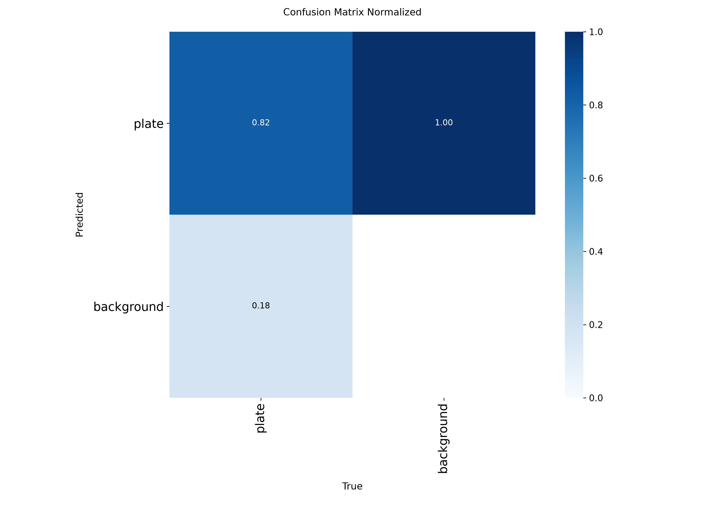 | 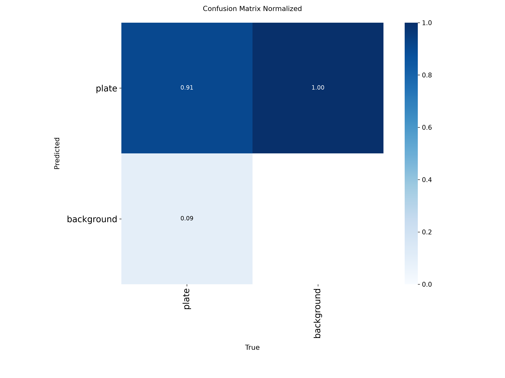 |

</details>

**Análisis:**
- [PENDIENTE: qué modelo detecta mejor y por cuánto]
- [PENDIENTE: coste en velocidad y tamaño de cada uno]
- [PENDIENTE: si el RT-DETR nativo y el de Ultralytics dan resultados parecidos]

### Pipeline de vídeo

La sección 6 procesa el vídeo de test con cualquiera de los tres detectores (`main(detector="yolo" | "rtdetr" | "rtdetr_nativo", ocr=...)`):

| Detector | Personas y vehículos | Matrículas | Tracking |
|---|---|---|---|
| `yolo` | `yolo11s.pt` a 960 px | YOLO11n a 1280 px | Ultralytics |
| `rtdetr` | `rtdetr-l.pt` a 640 px | RT-DETR-l a 640 px | Ultralytics |
| `rtdetr_nativo` | RT-DETRv2-L de COCO a 640 px | RT-DETRv2-L a 640 px | ByteTrack (`supervision`) |

YOLO se ejecuta por encima de su resolución de entrenamiento porque las matrículas del vídeo son pequeñas y así las detecta mejor. RT-DETR, en cambio, se mantiene a 640 px: a más resolución apenas detectaba matrículas.

Pasos en cada fotograma:
1. **Personas y vehículos:** el detector general con *tracking*, filtrado a persona, bicicleta, coche, moto, autobús y camión. El tracker recibe también las detecciones dudosas (confianza ≥ 0,1) para no perder objetos, pero solo se dibujan y guardan las de confianza ≥ 0,3.
2. **Matrículas:** el detector entrenado, con su propio tracker. Cada matrícula se asocia al vehículo cuya caja contiene su centro; si un vehículo tiene varias, se queda con la más fiable.
3. **Identificadores:** un objeto solo recibe un ID visible cuando su track lleva 5 fotogramas, y los IDs se numeran de forma consecutiva. Así, las detecciones falsas de un solo fotograma no cuentan en los totales.
4. **Conteo:** cada ID cuenta una vez, con la clase que más veces se le ha asignado.
5. **OCR (Tarea 2):** las matrículas se leen en segundo plano para no frenar el vídeo.
6. **Salidas:** el vídeo anotado, el CSV de detecciones, los totales, las matrículas leídas, el flujo y el vídeo anonimizado.

El CSV de detecciones tiene una fila por objeto y fotograma, con el formato propuesto en el enunciado:

```
fotograma, tipo_objeto, confianza, identificador_tracking, x1, y1, x2, y2, matricula_en_su_caso, confianza_matricula, mx1, my1, mx2, my2, texto_matricula
```

**Resultado con el vídeo de test** (YOLO + PaddleOCR-VL):

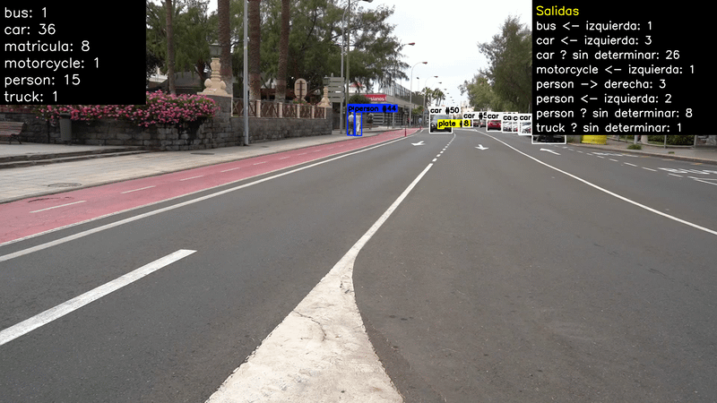


Vídeo completo se encuentra en el [DRIVE](https://drive.google.com/drive/folders/1z3AbIQVJxg9jMuxpYFPb0yNetClAjz53?usp=sharing)

| Clase | Total |
|---|---|
| Persona | 53 |
| Coche | 129 |
| Bicicleta | 1 |
| Moto | 2 |
| Autobús | 2 |
| Camión | 2 |
| Matrícula | 38 |

Se procesaron los 2832 fotogramas en 483 s (5,9 fps) y se leyeron 29 matrículas, 12 de ellas confirmadas por votación.
<!-- PENDIENTE: actualizar con la última ejecución (results/yolo_paddle_totales.csv) -->

**Problemas observados:**
- El total de coches es más alto que el número real de coches: cuando un coche queda tapado, o sale y vuelve a entrar, el tracker le da un ID nuevo y cuenta dos veces.

### Extra: flujo por direcciones

`ContadorFlujo` guarda la posición de cada ID la primera y la última vez que se ve. Cuando un ID lleva 1 s (25 fotogramas) sin verse, se decide por dónde ha salido:

1. Si su último centro estaba cerca de un borde (8 % del fotograma), sale por ese borde.
2. Si se perdió en medio de la imagen, cuenta la dirección dominante de su desplazamiento.
3. Si apenas se ha movido, cuenta como *sin determinar*.

Los totales se dibujan en la esquina superior derecha del vídeo y se guardan en `results/yolo_paddle_flujo.csv`.

| Clase | Izquierda | Derecha | Arriba | Abajo | Sin determinar |
|---|---|---|---|---|---|
| Persona | [PENDIENTE] | [PENDIENTE] | [PENDIENTE] | [PENDIENTE] | [PENDIENTE] |
| Coche | [PENDIENTE] | [PENDIENTE] | [PENDIENTE] | [PENDIENTE] | [PENDIENTE] |

### Extra: anonimización

Se genera un segundo vídeo en el que las personas y todas las matrículas se tapan con la imagen de un mandril:
- La imagen se escala para cubrir toda la caja sin deformarse.
- La caja se amplía un 5 % para que no asome nada por los bordes.
- Se trabaja sobre una copia del fotograma sin anotar, así que el vídeo principal no cambia.

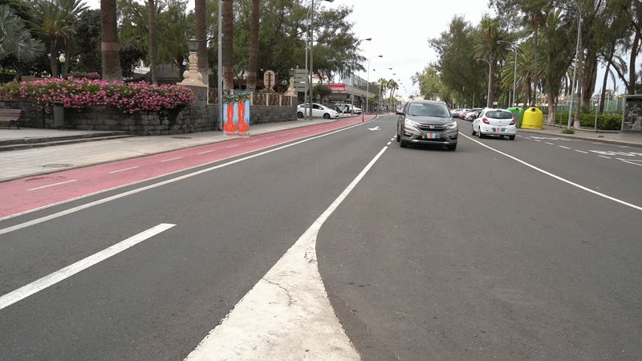


Vídeo completo se encuentra en el [DRIVE](https://drive.google.com/drive/folders/1z3AbIQVJxg9jMuxpYFPb0yNetClAjz53?usp=sharing)

------

## Tarea 2 — Reconocimiento de caracteres en las matrículas

### OCR

Se usan dos OCR (sección 4), uno de cada tipo:

- **Tesseract** (clásico), en modo de una sola línea y limitado a letras mayúsculas y números. A cada matrícula se le pasan hasta cuatro preparaciones del recorte, porque acierta con unas y falla con otras: gris con contraste mejorado (CLAHE), umbral de Otsu, umbral adaptativo y una versión en la que solo quedan las manchas con forma de carácter (sin marco, tornillos ni rejilla). Gana la lectura con formato español más repetida. Las versiones se leen en paralelo.
- **PaddleOCR-VL-1.5** (VLM de 0,9 B parámetros especializado en OCR), con la instrucción `OCR:`. Se le pasa la matrícula en color y ampliada a 96 px de alto, porque el modelo está entrenado con fotos reales.

En los dos casos se quita antes la franja azul europea, y la lectura se corrige con el formato de las matrículas españolas: la actual (`1234BCD`) y las provinciales de Canarias (`GC1234AB`, `TF123456`). Según la posición se corrigen las confusiones típicas, como `O`→`0` en la parte numérica u `8`→`B` en la de letras.

En el vídeo, `LectorMatriculas` decide qué leer y cuándo:
- Cada matrícula se lee como mucho cada 3 fotogramas, y solo si se ve al menos tan grande como en su mejor lectura.
- Las lecturas de cada ID se votan, y cada voto pesa según el tamaño de la matrícula.
- Una lectura con formato español que se repite 3 veces y pesa el doble que la siguiente queda confirmada, y esa matrícula ya no vuelve a pasar por el OCR.

### Comparativa: Tesseract vs PaddleOCR-VL

La sección 7 compara los dos OCR con las matrículas del dataset, cuyo texto real viene en las anotaciones:

- **Qué matrículas:** de todas las imágenes, porque los OCR no se entrenan y el reparto entrenamiento/validación no les afecta. Se descartan las matrículas sin texto real (`None`, `"None"` o vacío) y las de menos de 40 px de ancho, que son ilegibles.
- **Mismas condiciones:** los dos OCR reciben los mismos recortes, con el mismo preprocesado que en el vídeo.
- **Acierto:** lectura exacta, lecturas con como mucho un carácter mal y CER (errores de carácter divididos entre la longitud de la matrícula).
- **Tiempo en lote:** todas las matrículas en lotes de 16, como en el vídeo. Es la velocidad real del pipeline.
- **Latencia:** 30 matrículas leídas de una en una, que es lo que tarda en leerse una matrícula suelta.

**Tasa de acierto** ([PENDIENTE: nº] matrículas):

| OCR | Acierto exacto (%) | ≤ 1 error (%) | CER medio | Sin lectura (%) |
|---|---|---|---|---|
| Tesseract (clásico) | [PENDIENTE] | [PENDIENTE] | [PENDIENTE] | [PENDIENTE] |
| PaddleOCR-VL (VLM) | [PENDIENTE] | [PENDIENTE] | [PENDIENTE] | [PENDIENTE] |

**Tiempo por matrícula:**

| OCR | En lote (ms) | Latencia (ms) | Matrículas/s (lote) |
|---|---|---|---|
| Tesseract (clásico) | [PENDIENTE] | [PENDIENTE] | [PENDIENTE] |
| PaddleOCR-VL (VLM) | [PENDIENTE] | [PENDIENTE] | [PENDIENTE] |

**Acierto exacto según el ancho de la matrícula:**

| OCR | 40-70 px (%) | 70-110 px (%) | > 110 px (%) |
|---|---|---|---|
| Tesseract (clásico) | [PENDIENTE] | [PENDIENTE] | [PENDIENTE] |
| PaddleOCR-VL (VLM) | [PENDIENTE] | [PENDIENTE] | [PENDIENTE] |

<!-- PENDIENTE: copiar las tablas de results/comparativa_ocr/comparativa_ocr.md -->

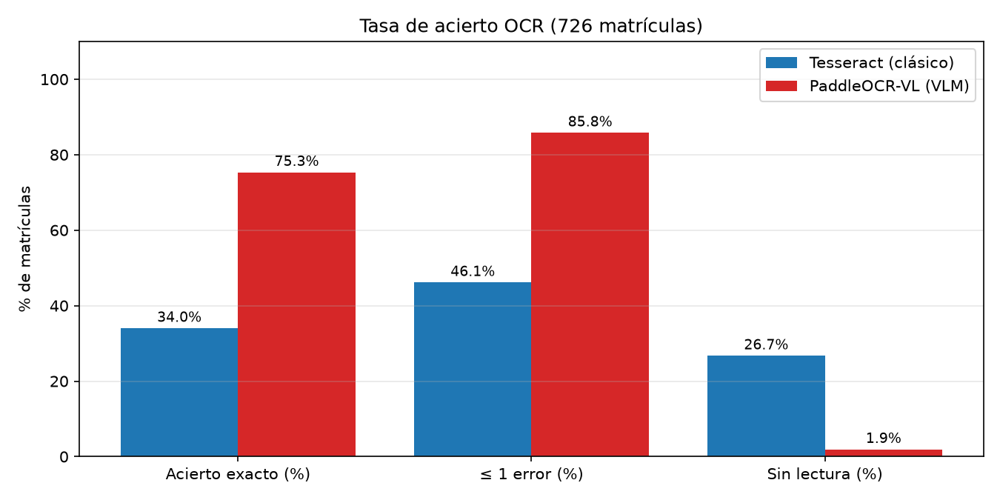

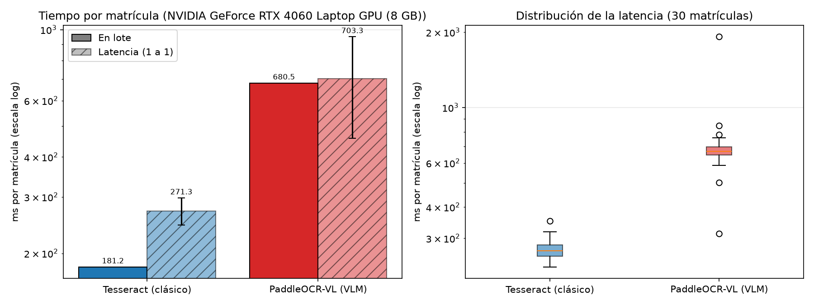

**Demostraciones de detección**

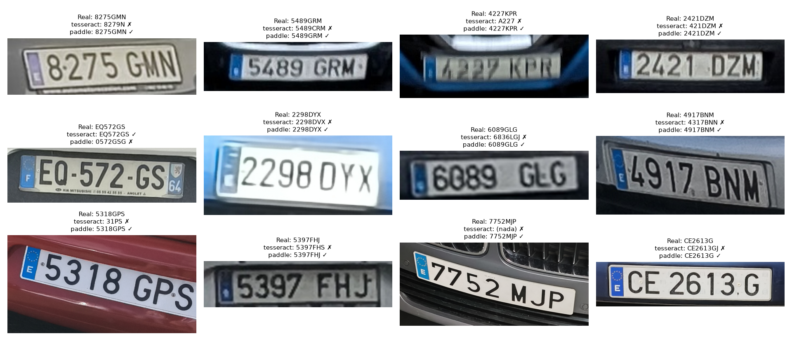


**Conclusiones:**
- [PENDIENTE: cuál acierta más y con qué tipo de matrículas falla cada uno]
- [PENDIENTE: diferencia de velocidad y si PaddleOCR-VL compensa su coste en el vídeo]

------

## Referencias

- [Guía de la Práctica 4](https://github.com/otsedom/otsedom.github.io/tree/main/VC/P4)
- [Guía de la Práctica 4b](https://github.com/otsedom/otsedom.github.io/tree/main/VC/P4b)
- [Ultralytics: YOLO y RT-DETR](https://docs.ultralytics.com/)
- [Repositorio oficial de RT-DETR](https://github.com/lyuwenyu/RT-DETR)
- [RT-DETR: DETRs Beat YOLOs on Real-time Object Detection](https://arxiv.org/abs/2304.08069)
- [RT-DETRv2: Improved Baseline with Bag-of-Freebies for Real-Time Detection Transformer](https://arxiv.org/abs/2407.17140)
- [supervision (ByteTrack)](https://github.com/roboflow/supervision)
- [Tesseract OCR](https://github.com/tesseract-ocr/tesseract)
- [PaddleOCR-VL-1.5](https://huggingface.co/PaddlePaddle/PaddleOCR-VL-1.5)
